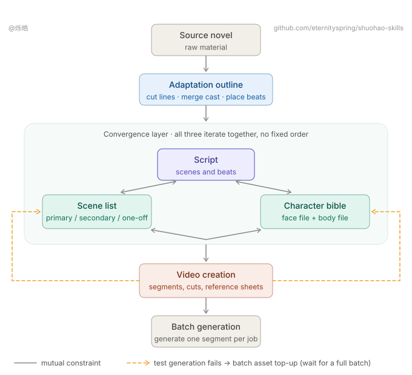
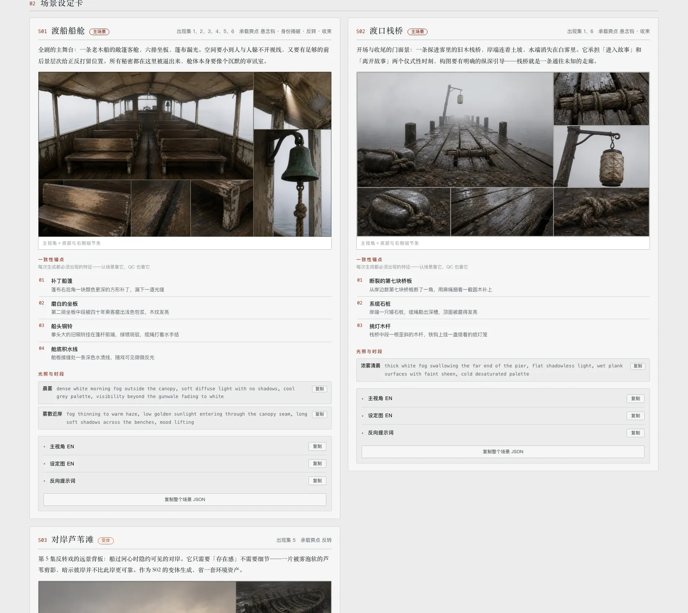
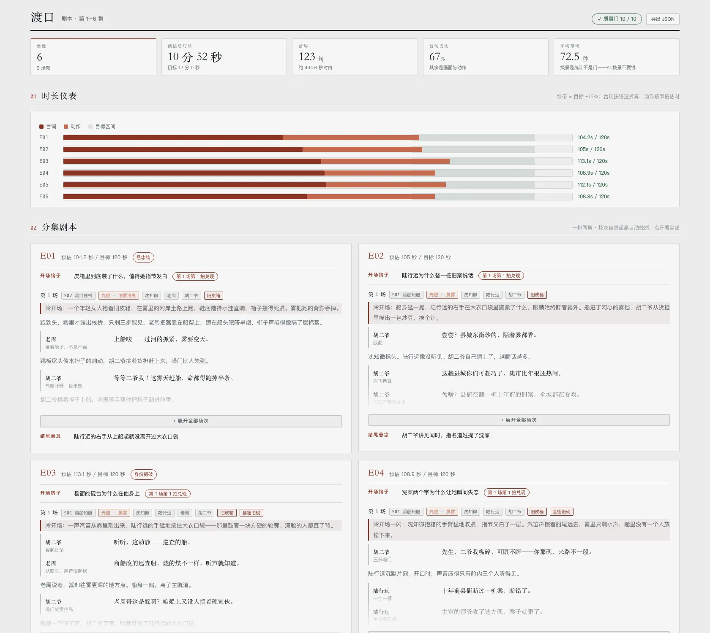

[中文](README.md) · **English**

> 👋 **Open to work / collaboration** — I'm between jobs right now, and this repo is what I build in that spare time.
> Happy to hear from anyone this resonates with. Besides **remote work**, I'm also open to a **half-collaboration**: a few thousand RMB a month for living costs plus a profit share. On-site trips are possible where the work genuinely needs them. What I'm really after is finding people on the same wavelength to build something in this AI wave.
> Email: **[eternityspring@gmail.com](mailto:eternityspring@gmail.com)** · Résumé: **[resume.79px.com](https://resume.79px.com)** · WeChat **`hao_dev`** (please mention `github` when you add me)
>
> These skills are free and open source, built and battle-tested on real AI short-drama production.
> If they save you an afternoon, consider [**buying me a coffee on Ko-fi**](https://ko-fi.com/eternityspring) ☕ — it keeps the updates coming.

# shuohao-skills

**Agent skills for AI short-drama production** — from an existing screenplay to production material: source coverage, structure and assets, one execution script, visual design, shot planning and optional generation. Built for AI coding agents, **runs in pi, Claude Code, and codex**.

The full pipeline has one fixed order: **outline → characters → art → script → creation**. Complete each stage and its handoff before starting the next. Do not skip, reverse or parallelize stages. Character identity belongs to characters; place and prop identity belongs to art. Each skill still works independently, without claiming a completed full pipeline.



| Skill | What it does |
| --- | --- |
| [**mint-setup**](skills/mint-setup/README.en.md) | Locks asset-image and video models, resolution tiers and independent aspect ratios, plus art style, languages and autopilot. Writes `production.json` at the work-directory root for the five creative skills. Optional creative requirements are plain language and independent of aspect ratio |
| [**mint-outline**](skills/mint-outline/README.en.md) | Accepts existing screenplays only. Tracks source versions and reading coverage, story structure, ordered events, episodes and pacing facts; no asset inventories or budgets. Partial sources remain partial; missing episodes, endings and answers are not invented |
| [**mint-characters**](skills/mint-characters/README.en.md) | Reads the original independently and owns character identity, aliases, stable IDs, evidence and character budgets. Profiles, voice and sheets are optional production tasks. Visual style comes from `production.json` |
| [**mint-art**](skills/mint-art/README.en.md) | Art bibles for AI production (scenes + narrative props): consistency anchors, lighting & state variants, scale references, no-people/no-hands white plates. Reads the original independently and owns stable place/prop identities, evidence and art budgets. Scene boundaries do not define place identities; mentioned objects need not become assets |
| [**mint-script**](skills/mint-script/README.en.md) | Forms one execution script from the original, retaining event claims and script-local references. Explicit `script.assetMappings` link local references to cast/art identities; matching names or ID strings never establish identity. Separates action, speech, subtitles, sound and non-speaking notes, and splits each scene into video segments in a storyboard document (start/end states, action rewrites, must-show information, sound and post-production captions). Per-episode targetSeconds is the sole execution target: optional for parsing, required before production. Independent authoring remains available |
| [**mint-creation**](skills/mint-creation/README.en.md) | Turns the script into segments and cuts, mounts existing character/scene/prop sheets without generating intermediate frames, and writes model-specific video prompts. `export` creates production packs; `videos` exports an offline plan; the separately installed ly-video skill generates and recovers tasks. Shot expression is reviewed against the guide; model limits remain deterministic checks |
| [**mint-video-prompt**](skills/mint-video-prompt/README.en.md) | The prompt writer: splits an episode into segments and cuts, writes each segment's prompt into a worksheet (`<segment>/prompt.md`) and submits it for review; revises and resubmits when changes are requested. Invoked as a subagent by mint-creation, or used on its own |
| [**mint-video-prompt-review**](skills/mint-video-prompt-review/README.en.md) | The prompt reviewer: independently checks worksheets against the script, assets, project brief and model conventions, records comments in the same worksheet and registers `approved`, `changes_requested` or `blocked`. It never rewrites the prompt |

**Every skill renders its report in English too** — reports default to a Chinese UI; pass `--lang en` to `render` for English interface labels (story content and raw diagnostics retain their original language). The UI language can also be settled once in `production.json`.

**To run the whole thing without interruptions**, switch on autopilot in `production.json` (`mint-setup init --autopilot`): reading `"autopilot": true`, each of the five creative skills runs its own stage end to end — no questions, no waiting for sign-off, deciding for itself and listing every decision in its final report. **Autopilot does not expand adaptation or rewriting permission or remove checks**. Without permission, organize sources and report expression gaps; candidates stay outside the execution script. Paid generation still requires current authorization. Off by default.

## Creative guides and data versions

Outline, script and creation each carry a self-contained `references/创作指南.md`. Store optional project requirements as natural-language `production.json.creativeBrief`. There are no four-dimensional profile selections, guide-version registries or policy-application commands. Source hashes identify the exact screenplay version, not the creative guide. Visual prose remains in `production.json.style`; framing does not dictate pacing.

JSON stores source facts and necessary handoff relationships. Outline no longer holds adaptation planning, arcs, event categories or fixed episode minutes. Source preservation is not an instruction to speak every sentence. One utterance can continue across shots without replay or repeated timing; actual repeated lines remain separate occurrences. Model duration limits remain hard constraints.

**One version per data contract:** outline is **v5 (story only)**, script is v4, production and creation are v3, characters and art are v1. Each skill reads and writes only its current version: there are no migration commands and no compatibility readers for older versions. A version mismatch is an error.

Notes, audio semantics, source relations and reveal restrictions reach writers and reviewers and bind affected worksheet approvals. Unrelated scenes do not invalidate them. Originals remain unchanged. Markdown/HTML displays are derived; `<segment>/prompt.md` remains an editable production worksheet. Report structural checks, source/script review and production-plan review separately. Prompt approval is not finished-video approval. This change adds no translation, rough-cut or finished-video review stage.

See [stage handoffs and version support](docs/阶段交接与版本支持.md) and the [implementation verification](docs/剧情与资产拆分-实施验收.md) (Chinese). `node scripts/pipeline.mjs` maintains project-level `pipeline.json`: ordered starts, stage validation and explicit handoffs, with no failure history. The earlier [implementation record](docs/剧本解析融合-实施验收.md) describes its historical version, not the current contract.

## One page for the whole pipeline

The five stage reports can be merged into a single page with a left-hand nav — **you get a pane for every stage you actually have**:

```bash
node scripts/report.mjs --from <demo-dir> --out report.html
```

`--from` discovers the five json files using the [working-directory layout](#working-directory-layout); you can also point at each one directly (`--outline` `--cast` `--art` `--script` `--creation`). Ran only the character pass? You get one pane. Ambiguous automatic discovery requires an explicit file path. Failed renderers are named in the report and cause a nonzero exit code.

It is an **assembler, not a separate skill**: it imports no skill code, it shells out to each skill's own `render --html` and stitches the results. The five creative skills provide their own renderers, still run standalone, and are still copyable on their own — and when a skill changes its rendering, this picks it up for free.

Merging solves three problems, **all of them inside the assembler, none inside the skills**:

- **Style bleed.** Reports reuse class names with different meanings (`.copy`, `.kpis`, `.badge`, `.chip`…), so every selector gets a scope prefix
- **Script bleed.** Each report's script does document-wide lookups like `document.querySelector('.expo')`. Merged, that only ever finds the first one — all five export buttons would break. Each script gets wrapped in a scoping proxy
- **Asset paths.** Each report's images are relative to its own json directory (`images/…`, `../art/images/…`) and get rebased against the output file

One pane shows at a time by default. "Show all" in the bottom-left expands every pane so Cmd+F reaches the whole document. Number keys `1`–`5` switch panes, and `#pane-script` deep-links straight to one.

```bash
node scripts/report-selftest.mjs   # assembler unit tests
node scripts/pipeline-selftest.mjs # real rendering, interaction adapters, isolated install tests
```

The following screenshots show historical interfaces. Render the local samples for the current report UI:

**mint-outline · story structure and evidence (v5)**

The old asset-report screenshot is retired. Render the stage's own sample with `render --html` for the current report.

**mint-characters · character bible**


**mint-art · art bible (scenes + props, sheets actually generated by the skill)**



**mint-script · screenplay (duration gauge + episode scripts + line book)**



**mint-creation · video creation (segments, cuts, reference mounts, prompts and ordering)**

Includes its own example and offline report renderer. See [mint-creation](skills/mint-creation/README.en.md).

The main session only dispatches in this stage: after `seed` it launches a **writer subagent** (mint-video-prompt), runs the structural checks, then launches a **reviewer subagent** (mint-video-prompt-review), and loops until every segment worksheet is approved before writing back to creation.json, exporting and handing off generation. Approval is bound to a segment's content and to the inputs it relies on, so regenerating a reference image, editing a claimed line or changing model parameters sends only the affected segments back to review. A segment still unapproved after three submissions, or one the reviewer marked as blocked, stops the loop and goes to the user. Without the two sibling skills installed, the subagents read the guide copies bundled with mint-creation; pi without a subagent extension launches separate `pi -p` processes through bash; only an environment that can neither dispatch nor start a separate process runs both roles serially in one session, and the report says the review was not independent.

## Install

```bash
git clone https://github.com/eternityspring/shuohao-skills.git
cd shuohao-skills
./scripts/install.sh
```

It detects whether you have pi, Claude Code, or codex installed and **symlinks** every skill into place — so `git pull` takes effect immediately. All 8 `novel-*` skills are now named `mint-*`; script entry points and writer/reviewer agent names have changed too. Run the installer again to replace this repository's old-name links, then reload skills or start a new session. Real directories and links to other sources are left untouched. Old commands and script paths are no longer provided.

```bash
./scripts/install.sh mint-characters   # just one skill
./scripts/install.sh --codex            # only into codex
./scripts/install.sh --pi               # only into pi
./scripts/install.sh --uninstall        # remove the symlinks
# Installing to pi also links the two role definitions in agents/pi/ into ~/.pi/agent/agents (the directory the subagent extension reads by default)
# Installing to Claude Code also links the two subagent definitions in agents/ into ~/.claude/agents
```

Prefer to do it by hand:

```bash
ln -s "$PWD/skills/mint-characters" ~/.claude/skills/mint-characters
ln -s "$PWD/skills/mint-characters" ~/.codex/skills/mint-characters
ln -s "$PWD/skills/mint-characters" ~/.pi/agent/skills/mint-characters
```

**pi has a second route**: install the whole repository as a pi package and all eight skills come in at once, with `git pull` still taking effect immediately:

```bash
pi install /path/to/shuohao-skills                        # local directory
pi install git:github.com/eternityspring/shuohao-skills   # straight from GitHub
```

The repository's root `skills/` directory is pi's convention directory — **no `package.json` required**. Once installed, `pi config` toggles them individually. A pi package does not carry role definitions; run `./scripts/install.sh --pi` once more if you want the writer and reviewer roles.

## What differs between the three agents

The workflow, the scripts and the artifacts are identical across all three. Only two things differ — **neither changes the result, only how you type the command and how fast it runs**:

| | pi | Claude Code | codex |
| --- | --- | --- | --- |
| Skill command | `/skill:mint-outline` | `/mint-outline` | `/mint-outline` |
| Sub-agent concurrency | The core ships without sub-agents, built-in todos or background bash; a subagent extension adds the `subagent` tool. Without it, mint-creation launches separate `pi -p` processes through bash for writing and review | Task | subagent |

Asking in plain words ("break this book down into characters", plus the path) works on all three and is equivalent to typing the command.

Creative steps can run serially when sub-agents are unavailable. Actual media generation and task recovery belong to the separately installed ly-image / ly-video skills, not local creative scripts.

## External generation skills

Install these first when you want generated media:

```bash
npx skills@latest add Din-Studio/skills --agent codex --skill ly-image ly-video -g -y
```

The user-level copies in `~/.agents/skills/` are also discoverable by pi. Reload skills or start a new session. Each creative skill remains standalone: `images` and `videos` now export plans only, even without `--dry-run`. Use `--out plan.json` to save a new plan. Read the stage's `references/media-handoff.md`, then the installed external skill, for live model discovery, request preparation, authorized submission, task recovery and output placement. Old generation flags are retired; never resubmit uncertain tasks.

## Requirements

| | Required? | Notes |
| --- | --- | --- |
| **Node** | Yes | ≥ 18. The skill scripts use only the standard library — **no npm dependencies, nothing to install** |
| **Model quota** | Yes | The writing stages use your current session's quota. **No API key needed** |
| **ly-image / ly-video skills** | Optional | Install separately from [Din-Studio/skills](https://github.com/Din-Studio/skills). Actual generation requires Node 22.20+ and private credentials; existing `~/.config/ly/config.json` is supported. Local writing, validation and plan export remain independent |

> **Note on output language.** These skills are Chinese-first. `mint-characters` produces Chinese character profiles even for an English source novel, and its validator actively rejects English in those fields. See that skill's README for what it would take to change.

## Repository conventions

One directory per skill, **self-contained and copyable on its own**:

```
skills/<skill-name>/
├── SKILL.md          the workflow the agent reads (required)
├── README.md         the docs a human reads
├── scripts/
│   ├── <name>.mjs    deterministic helpers, zero dependencies
│   └── selftest.mjs  self-test, never calls a model (required)
├── references/       detailed instructions, loaded on demand
├── examples/         bundled samples that double as test fixtures
└── assets/           screenshots
```

One file lives outside that layout: **`production.json` sits at the work-directory root**, not inside any skill's output directory. It holds the technical parameters the whole drama shares, and the four downstream skills find it by walking **up to 5 levels up** from their own output directory. Put it in a subdirectory and the other skills stop finding it.

Two hard requirements:

- Every skill must have a `SKILL.md`
- Every skill must have a `scripts/selftest.mjs` that **calls no model and costs no quota**, covering all deterministic logic

Run every self-test before adding a skill:

```bash
for f in skills/*/scripts/*selftest.mjs scripts/*-selftest.mjs; do node "$f" || exit; done
```

There is no CI. Run the local tests, including cross-stage integration and isolated-copy checks. **Only tested on macOS with Node 24**; there is no platform-specific code, so Linux and older Node releases should be fine, but that is unverified.

## Working-directory layout

Running an existing screenplay through the five ordered stages produces a pile of `*.json` / `*.md` / `*-report.html`. **Do not flatten them into the root.** Every skill except `mint-setup` writes into its own stage directory, one per pipeline stage:

```
<work-dir>/
├── production.json ← mint-setup's output: production parameters, **lives at the root**
├── pipeline.json   ← full-flow status; not required by standalone skills
├── outline/       ← mint-outline:    <drama>-outline.json / <drama>-outline-report.md / <drama>-outline-report.html
├── characters/    ← mint-characters: <drama>-cast.json / <drama>-cast-report.md / <drama>-cast-report.html
├── art/           ← mint-art:        <drama>-art.json / <drama>-art-report.md / <drama>-art-report.html
├── script/        ← mint-script:     <drama>-script.json / <drama>-script-storyboard.md / <drama>-script-report.md / <drama>-script-report.html
├── creation/      ← mint-creation: <drama>-creation.json / .md / creation-report.html
│   ├── manifest.json  ← from `export` (each segment's mounted reference list, no sheet files copied)
│   └── E01-01/…       ← one folder per segment (prompt.md + video.mp4 once ordered, no frame images)
├── docs/          ← notes you write yourself, kept apart from generated output
└── scripts/       ← helper scripts for running the pipeline
```

For the outline, characters, art, and script stages: Each formal delivery contains three files: `xxx.json`, `xxx-report.md`, and `xxx-report.html`; the script stage adds a fourth, the storyboard `xxx-storyboard.md`. Use the complete JSON filename without `.json` as the same `xxx` in all three names. Render both reports from that JSON and save them alongside it in the stage directory.

Key points:

- **`production.json` stays at the root**, never inside a stage directory — the five downstream skills walk up to find it, and a subdirectory hides it from all but one of them.
- **One directory per skill.** New characters or scenes go into the matching stage directory; the root stays clean.
- **Video packs belong in `creation/`**: `manifest.json` sits beside `E01-0x/`. Reference sheets remain under `characters/images/` and `art/images/`, linked by relative paths rather than copied into frame images.
- **Every skill checks its own landing spot.** When `validate` finds `production.json` it also compares where the artifact sits, and names the right directory if it is wrong. A misplaced file costs no re-rendering, so this is a notice rather than a gate — but staying silent would be worse, since `--from` discovery finds nothing when the files are flattened. With no `production.json` there is no way to tell where the work-directory root is, and the check says so instead of guessing.
- **`mint-creation` is the video-creation stage after the screenplay.** It supports both the five-stage merged report and standalone `render --html`. Its renderer requires `--script`; `--outline` supplies story facts only; reference identity comes from `--cast`, `--art` and explicit script mappings.
- **Report HTML can always be re-rendered** and images re-generated from the prompts — commit `json` / `md` / `docs` / `scripts` and gitignore the report HTML plus the `png` / `mp4` inside the segment folders.


## License

[Apache 2.0](LICENSE)
