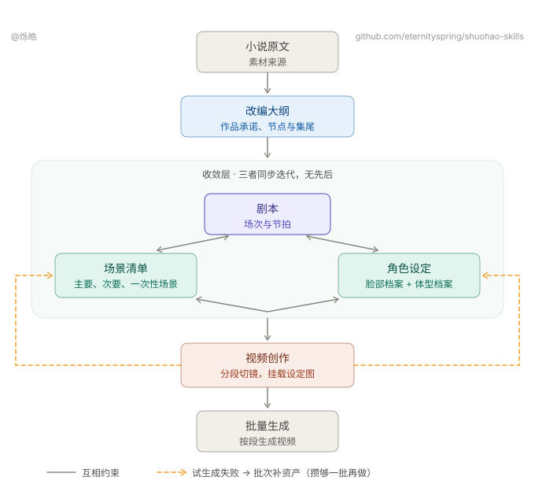

**中文** · [English](README.en.md)

> 👋 **找工作 / 合作** — 作者目前在空窗期，这个仓库就是业余的一点小探索。
> 有缘的朋友欢迎联系。**远程工作**之外，也接受**半合作**——每月几千块生活费 + 利润分成。如有必要，FED的话，也是可以考虑到场出差。希望在AI浪潮下，能找到同频朋友一起做点事情。
> 个人简历：**[resume.79px.com](https://resume.79px.com)**
> 
> 我建了一个 **AI 短剧交流群**（付费），聊 AI 短剧的工作流、工具和实操。
> 有兴趣的加我：**微信 `hao_dev`**，添加时**备注 `github`**。
>
> 

# shuohao-skills

**AI 短剧制作的 skill 集合**：从已有剧本到制作素材——核对原文与覆盖、提取结构与资产、整理唯一执行正文、设计角色与美术、编写分镜与提示词，再按需生成。面向 AI 编码 agent，**pi、Claude Code、codex 都能运行**。

完整流程固定为 **outline → characters → art → script → creation**。大纲只提取故事结构；人物阶段独立判定人物身份；美术阶段独立识别地点与物品；剧本阶段整理正文并核对显式映射；制作阶段规划交接。前序完成后才能进入下一阶段，不跳过、倒序或并行推进。单个 skill 仍可独立运行，但不能冒充完整流程。



| Skill | 做什么 |
| --- | --- |
| [**mint-setup**](skills/mint-setup) | 确认制作参数、视觉正文和自然语言创作要求，写入工作目录根的 `production.json`。画幅不决定叙事节奏 |
| [**mint-outline**](skills/mint-outline) | 只接受已有剧本，记录来源版本与已读范围，只提取故事、剧情节点、分集和节奏事实，不建立资产表。区分部分来源与全剧完整，不补写缺集、结局或问题答案 |
| [**mint-characters**](skills/mint-characters) | 独立读取原剧本，判定人物身份、别名和归并，维护稳定角色 ID、来源和预算。按需求制作画像、形象提示词、音色与设定图；身份登记不强制出图。画风整块取自 `production.json`。**`images` 只导出离线计划**；实际生图使用独立安装的 ly-image，参考依赖与目标路径保留 |
| [**mint-art**](skills/mint-art) | 给 AI 短剧出美术设定集（场景 + 叙事道具）：一致性锚点、光照与状态变体、尺度参照、无人无手白底提示词。独立读取原剧本识别地点和物品，维护稳定资产 ID、来源和美术预算；场次不等于地点，提及物品不自动成为道具资产。**`images` 只导出离线计划**；实际生图使用独立安装的 ly-image，参考依赖与目标路径保留 |
| [**mint-script**](skills/mint-script) | 对照原文形成唯一执行正文，保留事件认领和正文局部引用，通过 `script.assetMappings` 显式关联人物、美术身份，不按相同名称或 ID 猜测映射，区分行动、发声、字幕、声音和非发声说明，并按场拆分视频段、编写分镜文档（段首／段尾状态、动作复写、必须呈现的信息、声音与后期标注）。逐集 targetSeconds 是执行目标的唯一编辑源；整理时可缺省，制作前必须确认。独立创作入口保留 |
| [**mint-creation**](skills/mint-creation) | 参考图直出视频：按 script 分镜分段、在段内认领节拍，直接挂载已有的角色、场景与道具设定图，不生成中间分镜图。视频提示词按模型选择结构，`export` 输出投产包，`videos` 导出离线计划，独立安装的 ly-video 负责生成与恢复。镜头表达按指南评审，模型技术限制由工具检查 |
| [**mint-video-prompt**](skills/mint-video-prompt) | 视频提示词编写方：按剧本节拍完成一集的分段、分镜与提示词，写入每段一份的工作单 `<段号>/prompt.md` 并提交审核；被退回后逐条修改再提交。由 mint-creation 以 subagent 方式调用，也可以单独使用 |
| [**mint-video-prompt-review**](skills/mint-video-prompt-review) | 视频提示词审核方：独立对照剧本、资产、项目要求与模型口径审核工作单，把意见写进同一份工作单并登记 approved、changes_requested 或 blocked。只审核，不改写提示词 |

**五个创作 skill 的报告都支持中英双语界面**：默认中文，`render --lang en` 切换为英文界面（故事内容与原始诊断保持原文）。界面语言也可以在 `production.json` 里一处定死。

**要一路跑到底不被打断**，就在 `production.json` 里打开自动驾驶（`mint-setup init --autopilot`）：五个创作 skill 读到 `"autopilot": true` 就各自把自己那一段一口气跑完——不提问、不等拍板，该做的决定自己做，做过的决定全部写进汇报。**自动驾驶不扩大转译或改写授权，也不取消检查点**：权限未确认时只整理来源、标明性质和表达缺口；候选不进入正式执行正文。付费生成仍需符合当前授权。默认关闭。

## 创作指南与数据版本

创作方法集中在 outline、script、creation 各自的 `references/创作指南.md`。项目可在 `production.json.creativeBrief` 保存自然语言要求，不再选择四维 profile、维护指南版本或执行策略应用命令。视觉正文仍只来自 `production.json.style`。画幅不决定叙事节奏。

JSON 保存来源事实和必要交接关系。outline 不再保存改编取舍、阶段规划、事件分类或固定分钟数。来源位置不是发声指令；心理说明不会自动朗读。一次发声可跨镜延续，但正文只发生一次，重复台词按各自来源位置分别保留。模型时长上限仍是硬限制，估时不等于实际表演。

**数据契约只有一个版本**：outline 为 **v5（仅剧情）**，script 为 v4，production 与 creation 为 v3，人物与美术为 v1。每个 skill 只读写当前版本，不提供迁移命令，也不兼容读取旧版本；版本号不符直接报错。

新增说明、声音方式、来源关系及揭晓限制实际进入编写与审核材料，并绑定相关工作单批准。无关场次不连带失效。原件不可覆盖；Markdown/HTML 正文展示与报告均派生，`<段号>/prompt.md` 仍是可编辑的制作工作单。结构检查、来源／正文核验和制作计划审核分别报告；提示词批准不代表成片通过。本次不新增翻译、粗剪或成片审核。

职责、版本及流程入口见[阶段交接与版本支持](docs/阶段交接与版本支持.md)，逐项验证见[剧情与资产拆分实施验收](docs/剧情与资产拆分-实施验收.md)。完整流程使用 `node scripts/pipeline.mjs` 维护项目级 `pipeline.json`，逐阶段开始、校验和确认交接；不写失败累计日志。历史[剧本解析融合实施验收](docs/剧本解析融合-实施验收.md)记录的是当时版本，不代表当前契约。

## 合成一张单页

五段的报告可以合成一张单页，左侧导航切换——**有哪几段就出哪几个面板**：

```bash
node scripts/report.mjs --from <demo目录> --out report.html
```

`--from` 按下面的[工作目录约定](#工作目录约定)自动发现五份 json；也可以逐个指定（`--outline` `--cast` `--art` `--script` `--creation`）。只跑了角色那一段就只有一个面板，不报错。`production.json` 不单独生成面板；各阶段报告优先展示正文、交接关系与检查结果，`mint-setup show` 展示项目要求。自动发现遇到同阶段多份 JSON 时要求显式指定，不猜测版本。渲染失败的面板会明确标注，并返回非零退出码。

它是**组装器，不是独立 skill**：不 import 任何 skill 的代码，而是调各自的 `render --html` 拿产物再拼装。五个创作 skill 各自提供渲染入口，仍然独立可跑、可以单独拷走；某个 skill 改了渲染，这边自动跟上。

合并时处理三件事——**这三件都在组装器里做，不侵入 skill**：

- **样式串味**。各报告存在同名不同定义的类（`.copy` `.kpis` `.badge` `.chip`……），所以给每份样式的每条选择器加作用域前缀
- **脚本串味**。各报告的脚本都是 `document.querySelector('.expo')` 这种全局查询，合成一页后只会命中第一个——五个导出按钮会全废。做法是给每份脚本套一层作用域代理
- **图片路径**。各报告的图相对自己那份 json 的目录（`images/…`、`../art/images/…`），合成后按输出文件的位置重算

默认一次显示一个面板。左下角「平铺全部」把所有面板同时展开，Cmd+F 恢复全局搜索。数字键 `1`–`5` 切面板，`#pane-script` 这样的深链可以直接分享到某一屏。

```bash
node scripts/report-selftest.mjs   # 合并器单元测试
node scripts/pipeline-selftest.mjs # 真实渲染、交互适配与隔离安装测试
```

提供已有剧本后，按阶段生成以下产物。下列截图为历史界面示意；当前界面以本地 `render` 为准：

**mint-outline · 剧情结构与来源（v5）**

旧资产报告截图已退役。当前报告请使用本阶段自有样例运行 `render --html` 重建。

**mint-characters · 角色设定集**


**mint-art · 美术设定集（场景 + 道具，设定图为 skill 实际生成）**


**mint-script · 剧本（时长仪表 + 分集剧本 + 台词本）**


**mint-creation · 视频创作（分段切镜、参考图挂载、视频提示词与下单）**

自带《收书人》样例与离线报告渲染，详见 [mint-creation](skills/mint-creation)。

这一阶段的主会话只调度：`seed` 之后派发**编写 subagent**（加载 mint-video-prompt）写分镜与提示词，结构检查通过后派发**审核 subagent**（加载 mint-video-prompt-review），循环到每段工作单都是 approved，再回写 creation.json、导出投产包、交接生成。批准绑定这一段的内容与它依据的输入，设定图重新生成、认领的台词被修改或更换模型参数之后，只有受影响的段需要重新审核。同一段提交三轮仍未批准，或审核方登记了阻塞时停止循环，交给用户。没有安装两个兄弟 skill 时，subagent 读取 mint-creation 自带的指南副本；pi 没有子代理扩展时通过 bash 启动独立的 `pi -p` 进程；只有不能派发、也不能启动独立进程的环境才在同一会话串行完成，并注明审核不独立。

## 安装

```bash
git clone https://github.com/eternityspring/shuohao-skills.git
cd shuohao-skills
./scripts/install.sh
```

自动检测本机安装了 pi、Claude Code 还是 codex，把所有 skill **软链**过去——`git pull` 之后立刻生效，不需要重新安装。本版本将全部 8 个 `novel-*` skill 改名为 `mint-*`，脚本入口和编写／审核角色名称同步改名。更新后请执行一次安装脚本，清理指向本仓库的旧名称软链并安装新名称，再重新加载技能或启动新会话；真实目录与其他来源软链不会删除。旧命令与旧脚本路径不再提供。

```bash
./scripts/install.sh mint-characters   # 只安装某一个
./scripts/install.sh --codex            # 只安装到 codex
./scripts/install.sh --pi               # 只安装到 pi
./scripts/install.sh --uninstall        # 取消软链
# 安装到 pi 时，同时把 agents/pi/ 下的两个角色定义链接到 ~/.pi/agent/agents（子代理扩展默认读取的目录）
# 安装到 Claude Code 时，同时把 agents/ 下的两个 subagent 定义链接到 ~/.claude/agents
```

不想用脚本就自己链：

```bash
ln -s "$PWD/skills/mint-characters" ~/.claude/skills/mint-characters
ln -s "$PWD/skills/mint-characters" ~/.codex/skills/mint-characters
ln -s "$PWD/skills/mint-characters" ~/.pi/agent/skills/mint-characters
```

**pi 还有第二条路**：把整个仓库当成 pi 包安装，八个 skill 一次全进来，`git pull` 同样立刻生效：

```bash
pi install /path/to/shuohao-skills                        # 本地目录
pi install git:github.com/eternityspring/shuohao-skills   # 直接从 GitHub
```

仓库根的 `skills/` 就是 pi 的约定目录，**不需要 `package.json`**。安装完 `pi config` 里可以逐个开关。pi 包不携带角色定义；需要编写方与审核方的角色定义时，再运行一次 `./scripts/install.sh --pi`。

## 三个 agent 的差别

工作流、脚本、产出三家完全一样，不同的只有两处——**都不影响结果，只影响怎么打命令和跑多快**：

| | pi | Claude Code | codex |
| --- | --- | --- | --- |
| skill 命令 | `/skill:mint-outline` | `/mint-outline` | `/mint-outline` |
| 子代理并发 | 内核不带子代理，也没有内置待办与后台 bash；安装子代理扩展后有 `subagent` 工具。mint-creation 没有扩展时通过 bash 启动独立的 `pi -p` 进程完成编写与审核 | Task | subagent |

直接用中文说「帮我拆一下这本书的角色」并给出路径，三家都能唤起，与打命令等价。

本仓库不再内置生成编排。实际生成由独立安装的 ly-image / ly-video 执行；任务恢复使用外部回执，不通过重跑本地 `images` / `videos` 重新提交。

## 外部生成技能

需要实际生图、生视频时，先安装：

```bash
npx skills@latest add Din-Studio/skills --agent codex --skill ly-image ly-video -g -y
```

用户级副本位于 `~/.agents/skills/`，pi 也能发现；安装后重新加载技能或启动新会话。各创作 skill 仍自包含：`images` / `videos` 现在只导出计划，即使不带 `--dry-run` 也不提交。使用 `--out plan.json` 保存新计划。

实际生成先阅读对应阶段的 `references/media-handoff.md`，再读取已安装外部 skill。由外部 skill 完成实时模型发现、请求预览、授权提交、原任务恢复与下载；核验后放到计划 output 路径再渲染报告。旧生成选项已退役；不得因提交状态不确定而自动重投。

## 前置条件

| | 必需？ | 说明 |
| --- | --- | --- |
| **Node** | 必需 | ≥ 18。skill 的脚本只用标准库，**没有 npm 依赖，不需要 install** |
| **模型额度** | 必需 | 写文本的部分用你当前会话的额度，**不需要任何 API key** |
| **ly-image / ly-video skills** | 可选 | 从 [Din-Studio/skills](https://github.com/Din-Studio/skills) 独立安装。实际生成需要 Node 22.20+ 和私有凭据，可复用 `~/.config/ly/config.json`。本仓库创作、校验和计划导出仍可独立运行 |

## 仓库约定

每个 skill 一个目录，**自包含、可以单独拷走**：

```
skills/<skill-name>/
├── SKILL.md          给 agent 读的工作流（必需）
├── README.md         给人读的说明
├── scripts/
│   ├── <name>.mjs    确定性工具，零依赖
│   └── selftest.mjs  自测，不调模型（必需）
├── references/       按需加载的详细指令
├── examples/         自带样例，同时当测试夹具
└── assets/           截图
```

两条硬要求：

- 每个 skill 必须有 `SKILL.md`
- 每个 skill 必须有 `scripts/selftest.mjs`，**不调用模型、不花额度**，覆盖全部确定性逻辑

加新 skill 之前，先把全部自测跑一遍：

```bash
for f in skills/*/scripts/*selftest.mjs scripts/*-selftest.mjs; do node "$f" || exit; done
```

没有配置 CI。自测在本地运行，包含跨阶段联合测试和独立拷贝检查。**已在 macOS + Node 22/24 上验证**；代码没有平台相关调用，Linux 和更低版本 Node 理论上没问题，但没验。

## 工作目录约定

把已有剧本按固定顺序完成五段（大纲 → 角色 → 美术 → 剧本 → 视频创作），会产出大量 `*.json` / `*.md` / `*-report.html`。**不要平铺在根目录**，按五个 skill 各建一个目录归档，一眼对应流水线五段：

```
<demo>/
├── production.json ← mint-setup 产出：生产参数，**住在根目录**，下游向上找它
├── pipeline.json   ← 完整流程状态；独立运行单个 skill 不需要
├── outline/       ← mint-outline 产出：<剧>-outline.json / <剧>-outline-report.md / <剧>-outline-report.html
├── characters/    ← mint-characters 产出：<剧>-cast.json / <剧>-cast-report.md / <剧>-cast-report.html
├── art/           ← mint-art 产出：<剧>-art.json / <剧>-art-report.md / <剧>-art-report.html
├── script/        ← mint-script 产出：<剧>-script.json / <剧>-script-storyboard.md / <剧>-script-report.md / <剧>-script-report.html
├── creation/      ← mint-creation 产出：<剧>-creation.json / .md / -report.html
│   ├── manifest.json  ← export 产出（每段的参考图挂载清单，不复制设定图文件）
│   └── E01-01/…       ← 每段一个文件夹（prompt.md 工作单：审核状态、分镜结构、审核意见与提示词正文；下单后的 video.mp4，没有分镜图）
├── docs/          ← 自己写的使用说明、PR 草稿等（与机器产物解耦）
└── scripts/       ← 跑管线的辅助脚本（探索期脚本用 _ 前缀保留溯源）
```

outline、characters、art、script 四个阶段：正式交付固定包含 `xxx.json`、`xxx-report.md`、`xxx-report.html` 三个文件；script 阶段另有第四个文件 `xxx-storyboard.md`（分镜）。`xxx` 是同一份 JSON 去掉 `.json` 后的完整文件名；两份报告由该 JSON 渲染，并与它放在同一阶段目录。

约定要点：

- **`production.json` 住在根目录，不进子目录**——它是整部剧共用的技术参数，五个下游 skill 从自己的输出目录**向上最多 5 层**找它。放进某个子目录，别的 skill 就找不到了
- **每个 skill 一个目录**，装它自己的 `json` / `md` / `html` 三件套，加新角色/场景只往对应目录放，不污染根目录
- **视频投产包归 `creation/`**：`manifest.json` 与 `E01-0x/` 同级。参考图仍住在 `characters/images/` 与 `art/images/`，通过相对路径引用，不复制为分镜图。
- **报告 HTML 可由 `render` 重跑再生，图与视频可按提示词重出**——进版本控制时建议只提交 `json` / `md` / `docs` / `scripts`，报告 HTML 和段文件夹里的 `png` / `mp4` 用 `.gitignore` 排除，保持仓库轻量
- 用法类文档（如各报告的使用说明）放 `docs/`，与 skill 自动生成的产物分开，方便单独维护

**五个 skill 各自会核对落点**：`validate` 找到 `production.json` 就顺带比对产物在不在自己那一格，放错了点名该去哪。落点写错不用重出图，所以是提示不是门；但不说出来更坏——`--from` 自动发现按段目录名找 JSON，平铺在根目录它一份也找不到。没有 `production.json` 的老项目、单跑某一段的场合无从判断工作目录根在哪，那时明说跳过。

**`mint-creation` 是剧本之后的视频创作阶段**，接入五段合并报告，也支持独立 `render --html`。合并报告渲染这一阶段需要 `--script`；`--outline` 只提供剧情；参考图身份来自 `--cast`、`--art` 和正文的显式映射。

> 这套结构来自《渡口》端到端 demo 的实际归档经验，demo 的工作目录在本仓库之外，这里固化成约定，并由五个 skill 各自核对。


## License

[Apache 2.0](LICENSE)
