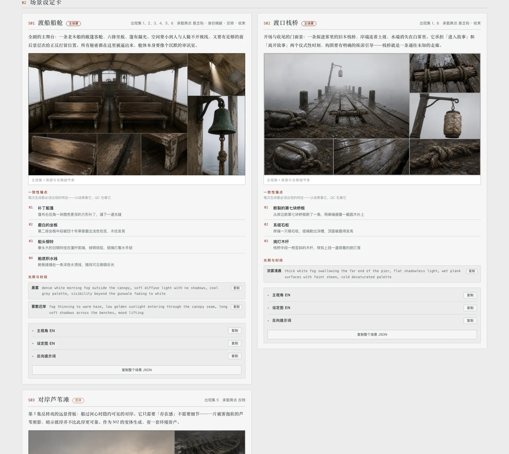
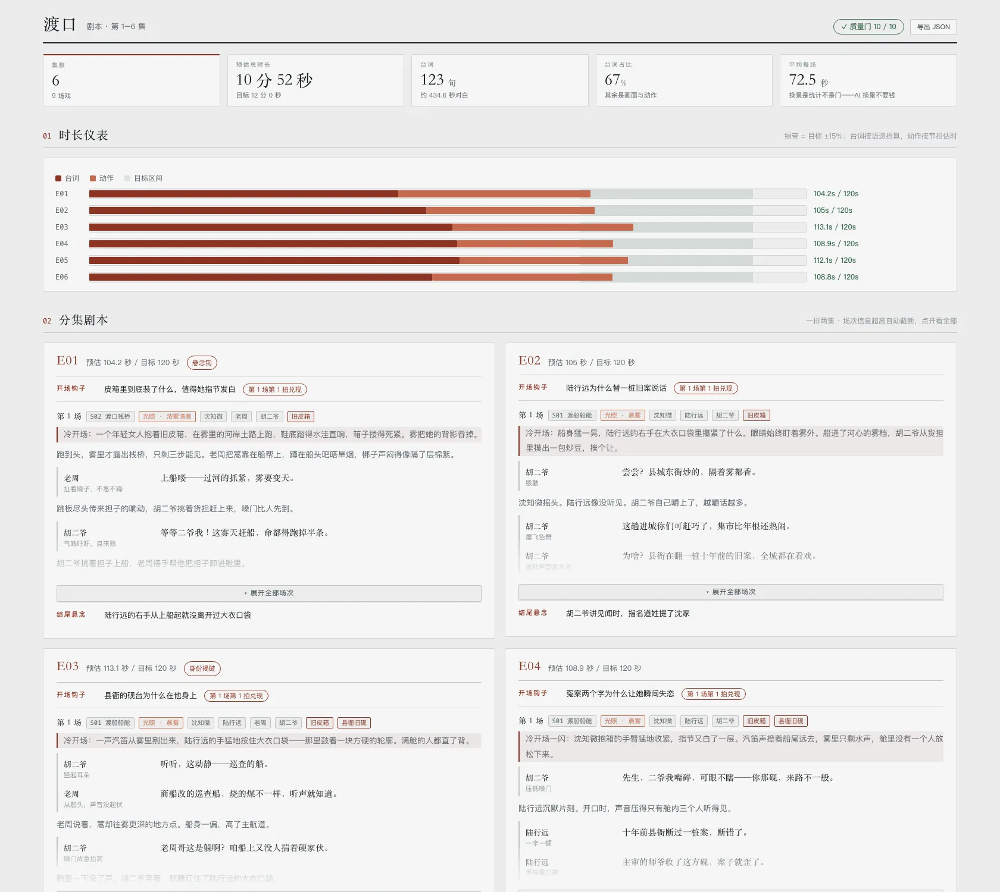

**中文** · [English](README.en.md)

> 👋 **找工作 / 合作** — 作者目前在空窗期，这个仓库就是业余的一点小探索。
> 有缘的朋友欢迎联系。**远程工作**之外，也接受**半合作**——每月几千块生活费 + 利润分成。如有必要，FED的话，也是可以考虑到场出差。希望在AI浪潮下，能找到同频朋友一起做点事情。
> 个人简历：**[resume.79px.com](https://resume.79px.com)**
> 
> 我建了一个 **AI 短剧交流群**（付费），聊 AI 短剧的工作流、工具和实操。
> 有兴趣的加我：**微信 `hao_dev`**，添加时**备注 `github`**。
>
> 

# shuohao-skills

**AI 短剧制作的 skill 集合**：从一本小说到直接喂生成管线的制作素材——定生产参数、拆角色、排大纲、出场景与道具设定、写剧本、切分镜、参考图直出视频。Cloud execution is packaged in **products/mint-drama** for Mint's host-managed Pi runtime.

整条管线长这样——**生产参数先定死画幅与模型，改编大纲收敛结构，剧本、场景、角色三者同步迭代，视频创作按剧本分段切镜，直接挂载已有设定图**：


| Skill | 做什么 |
| --- | --- |
| [**mint-setup**](skills/mint-setup) | 确认制作参数、视觉正文和自然语言创作要求，写入工作目录根的 `production.json`。画幅不决定叙事节奏 |
| [**mint-outline**](skills/mint-outline) | 建立作品承诺、稳定剧情节点、分集与集尾计划、可选阶段里程碑和资产清单。创作方法读取本地指南，不强制兑现频率、悬念或终局胜利 |
| [**mint-characters**](skills/mint-characters) | 把大纲定下的角色做成角色设定集：人物画像、形象提示词、音色提示词、角色设定图。吃 outline.json 预填角色表，报告语言可选，画风整块取自 `production.json`。**`images` 只导出离线计划**；Host canvas_cli handles authorized generation, preserving reference dependencies and output paths |
| [**mint-art**](skills/mint-art) | 给 AI 短剧出美术设定集（场景 + 叙事道具）：一致性锚点、光照与状态变体、尺度参照、无人无手白底提示词。吃 outline.json 预填清单，基础契约与制作参数由脚本检查。**`images` 只导出离线计划**；Host canvas_cli handles authorized generation, preserving reference dependencies and output paths |
| [**mint-script**](skills/mint-script) | 编写场次与节拍流，按 ID 认领大纲节点，定位开场与集尾，严格对账上游目标时长。开场落点按需标记，结束坐标由正文计算；估算不等于真实表演时长 |
| [**mint-creation**](skills/mint-creation) | 参考图直出视频：按剧本分段、切镜，直接挂载已有的角色、场景与道具设定图，不生成中间分镜图。视频提示词按模型选择结构，`export` 输出投产包，`videos` 导出离线计划，Host canvas_cli handles authorized generation, task inspection and downloads.镜头表达按指南评审，模型技术限制由工具检查 |
| [**mint-video-prompt**](skills/mint-video-prompt) | 视频提示词编写方：按剧本节拍完成一集的分段、分镜与提示词，写入每段一份的工作单 `<段号>/prompt.md` 并提交审核；被退回后逐条修改再提交。Dispatched by mint-creation through the isolated mint_prompt workflow |
| [**mint-video-prompt-review**](skills/mint-video-prompt-review) | 视频提示词审核方：独立对照剧本、资产、项目要求与模型口径审核工作单，把意见写进同一份工作单并登记 approved、changes_requested 或 blocked。只审核，不改写提示词 |

**五个创作 skill 的报告都支持中英双语界面**：默认中文，`render --lang en` 切换为英文界面（故事内容与原始诊断保持原文）。界面语言也可以在 `production.json` 里一处定死。

**要一路跑到底不被打断**，就在 `production.json` 里打开自动驾驶（`mint-setup init --autopilot`）：五个创作 skill 读到 `"autopilot": true` 就各自把自己那一段一口气跑完——不提问、不等拍板，该做的决定自己做，做过的决定全部写进汇报。**转移的是审批权，不是取消检查点**：质量门照样是门、花钱前照样先算账、失败的止损照样止损。默认是关的。

## 创作指南与数据版本

创作方法集中在 outline、script、creation 各自的 `references/创作指南.md`。项目可在 `production.json.creativeBrief` 保存自然语言要求，不再选择四维 profile、维护指南版本或执行策略应用命令。视觉正文仍只来自 `production.json.style`。画幅不决定叙事节奏。

JSON 保存故事内容和必要交接关系。原创不强制填写改编取舍；问题追踪、阶段规划和事件分类按需填写。重要节点认领、资产引用、明确的问题承诺和模型技术限制仍检查。时长估算是提醒，不等于真实表演时长。

**破坏性升级**：production、outline、script、creation 使用 `schemaVersion: 3`。旧项目先备份，按各 skill 的迁移说明执行 `migrate-v3` 预览，再审阅语义合并项并输出新文件；不能仅修改版本号。指南修改不会令既有产物失效。结构检查和内容评审分开报告，缺少上游时不得宣称联合交付通过。

## 合成一张单页

五段的报告可以合成一张单页，左侧导航切换——**有哪几段就出哪几个面板**：

Developer-only report rendering check from the repository root; the cloud model uses each stage's mint_skill render instead:

```sh
node scripts/report.mjs --from <demo目录> --out report.html
```

`--from` 按下面的[工作目录约定](#工作目录约定)自动发现五份 json；也可以逐个指定（`--outline` `--cast` `--art` `--script` `--creation`）。只跑了角色那一段就只有一个面板，不报错。`production.json` 不单独生成面板；各阶段报告优先展示正文、交接关系与检查结果，`mint-setup show` 展示项目要求。自动发现遇到同阶段多份 JSON 时要求显式指定，不猜测版本。渲染失败的面板会明确标注，并返回非零退出码。

它是**组装器，不是独立 skill**：不 import 任何 skill 的代码，而是调各自的 `render --html` 拿产物再拼装。五个创作 skill 各自提供渲染入口，仍然独立可跑、可以单独拷走；某个 skill 改了渲染，这边自动跟上。

合并时处理三件事——**这三件都在组装器里做，不侵入 skill**：

- **样式串味**。各报告存在同名不同定义的类（`.copy` `.kpis` `.badge` `.chip`……），所以给每份样式的每条选择器加作用域前缀
- **脚本串味**。各报告的脚本都是 `document.querySelector('.expo')` 这种全局查询，合成一页后只会命中第一个——五个导出按钮会全废。做法是给每份脚本套一层作用域代理
- **图片路径**。各报告的图相对自己那份 json 的目录（`images/…`、`../art/images/…`），合成后按输出文件的位置重算

默认一次显示一个面板。左下角「平铺全部」把所有面板同时展开，Cmd+F 恢复全局搜索。数字键 `1`–`5` 切面板，`#pane-script` 这样的深链可以直接分享到某一屏。

Developer-only terminal self-tests from the repository root:

```sh
node scripts/report-selftest.mjs   # assembler unit tests
node scripts/pipeline-selftest.mjs # real rendering, interaction adapters, isolated install tests
```

提供小说后，按阶段生成以下产物。下列截图为历史界面示意；当前界面以本地 `render` 为准：

**mint-outline · 短剧改编大纲**


**mint-characters · 角色设定集**


**mint-art · 美术设定集（场景 + 道具，设定图为 skill 实际生成）**



**mint-script · 剧本（时长仪表 + 分集剧本 + 台词本）**



**mint-creation · 视频创作（分段切镜、参考图挂载、视频提示词与下单）**

自带《收书人》样例与离线报告渲染，详见 [mint-creation](skills/mint-creation)。

The main session seeds inputs, dispatches the isolated mint-video-prompt-writer workflow, runs deterministic prompts check, then dispatches mint-video-prompt-reviewer independently. Only valid approved worksheets can be applied, exported and handed off. Approval binds segment content and its beat/reference/model/requirement inputs; changes invalidate only affected segments. Stop after three submissions without approval, two consecutive structural failures for the same reason, or a blocked review. Resolve blockers with the user or upstream before continuing. Generation remains a separate authorized canvas phase.

## Mint cloud product

[products/mint-drama](products/mint-drama) assembles the eight canonical skills, prompt roles and workflow into a self-contained product package. Developers run the following in that directory with Node 24 and the package's pinned pnpm version:

```sh
pnpm install --frozen-lockfile
pnpm assemble
pnpm test
```

These are developer-only commands. The model does not invoke bash, install packages or execute scripts. It uses workspace read/write/edit/find/grep/ls and deterministic tool calls:

```text
mint_skill({skill:"mint-setup",args:["init","--aspect","9:16","--video-model","MiniMax H3","--video-resolution","768p"]})
```

Args preserve CLI operation/option tokens without node or a script path. All artifact paths are workspace-relative. Use supported --out flags for exports; for stdout-only init/seed/render operations, save successful stdout with write. There are no pipes, redirection, directory changes or shell globs. Deterministic scripts retain standard-library-only implementations and do not import sibling skills.

Writer and reviewer use `workflow({name:"mint_prompt",args:{role:"mint-video-prompt-writer",task:"<complete brief>"}})` and role mint-video-prompt-reviewer. Briefs supply absolute packaged guide paths and workspace-relative input/worksheet paths. These foreground isolated Pi sessions share host model/authentication and cannot delegate. The main session runs mint_skill prompts check between them. workflow_control accepts status or cancel with runId; after interruption inspect worksheets and resume only the unfinished phase with a new workflow call.

The host supplies canvas_cli, connection identity and credentials. Plans map to supported canvas nodes and ordered references, then authorized run, tasks/resources inspection and download to expected workspace outputs. Read each stage's media-handoff reference. Preserve content/input hashes and approvals; unsupported parameters block handoff. No --session, daemon pairing, CLI subprocess or personal credentials. Autopilot does not add spending authority, and uncertain/completed tasks are not resubmitted.

Local package and fake-transport tests do not establish real cloud approval, billing, browser delivery or generation quality; those checks belong to later Mint integration.

## 仓库约定

每个 skill 一个目录，**自包含、可以单独拷走**：

```
skills/<skill-name>/
├── SKILL.md          给 agent 读的工作流（必需）
├── README.md         给人读的说明
├── scripts/
│   ├── <name>.mjs    确定性工具，零依赖
│   └── selftest.mjs  自测，不调模型（必需）
├── references/       按需加载的详细指令
├── examples/         自带样例，同时当测试夹具
└── assets/           截图
```

两条硬要求：

- 每个 skill 必须有 `SKILL.md`
- 每个 skill 必须有 `scripts/selftest.mjs`，**不调用模型、不花额度**，覆盖全部确定性逻辑

加新 skill 之前，先把全部自测跑一遍：

Developer-only terminal self-test sweep from the repository root:

```sh
for f in skills/*/scripts/*selftest.mjs scripts/*-selftest.mjs; do node "$f" || exit; done
```

There is no CI. Local tests cover cross-stage integration, migration and isolated-copy checks. The cloud product requires Node 24.22.1+. Some legacy suites require POSIX paths and file symlinks; use Linux for the complete sweep. See the [integration verification record](docs/mint-cloud-runtime-integration-plan.md#verification-record) for actual results and deferred cloud checks.

## 工作目录约定

把一本小说从头跑完五段（大纲 → 角色 → 美术 → 剧本 → 视频创作），会产出大量 `*.json` / `*.md` / `*-report.html`。**不要平铺在根目录**，按五个 skill 各建一个目录归档，一眼对应流水线五段：

```
<demo>/
├── production.json ← mint-setup 产出：生产参数，**住在根目录**，下游向上找它
├── outline/       ← mint-outline 产出：<剧>-outline.json / .md / -report.html
├── characters/    ← mint-characters 产出：<剧>-cast.json / .md / -report.html
├── art/           ← mint-art 产出：<剧>-art.json / .md / -report.html
├── script/        ← mint-script 产出：<剧>-script.json / .md / -report.html
├── creation/      ← mint-creation 产出：<剧>-creation.json / .md / -report.html
│   ├── manifest.json  ← export 产出（每段的参考图挂载清单，不复制设定图文件）
│   └── E01-01/…       ← 每段一个文件夹（prompt.md 工作单：审核状态、分镜结构、审核意见与提示词正文；下单后的 video.mp4，没有分镜图）
├── docs/          ← 自己写的使用说明、PR 草稿等（与机器产物解耦）
└── scripts/       ← 跑管线的辅助脚本（探索期脚本用 _ 前缀保留溯源）
```

约定要点：

- **`production.json` 住在根目录，不进子目录**——它是整部剧共用的技术参数，五个下游 skill 从自己的输出目录**向上最多 5 层**找它。放进某个子目录，别的 skill 就找不到了
- **每个 skill 一个目录**，装它自己的 `json` / `md` / `html` 三件套，加新角色/场景只往对应目录放，不污染根目录
- **视频投产包归 `creation/`**：`manifest.json` 与 `E01-0x/` 同级。参考图仍住在 `characters/images/` 与 `art/images/`，通过相对路径引用，不复制为分镜图。
- **报告 HTML 可由 `render` 重跑再生，图与视频可按提示词重出**——进版本控制时建议只提交 `json` / `md` / `docs` / `scripts`，报告 HTML 和段文件夹里的 `png` / `mp4` 用 `.gitignore` 排除，保持仓库轻量
- 用法类文档（如各报告的使用说明）放 `docs/`，与 skill 自动生成的产物分开，方便单独维护

**五个 skill 各自会核对落点**：`validate` 找到 `production.json` 就顺带比对产物在不在自己那一格，放错了点名该去哪。落点写错不用重出图，所以是提示不是门；但不说出来更坏——`--from` 自动发现按段目录名找 JSON，平铺在根目录它一份也找不到。没有 `production.json` 的老项目、单跑某一段的场合无从判断工作目录根在哪，那时明说跳过。

**`mint-creation` 是剧本之后的视频创作阶段**，接入五段合并报告，也支持独立 `render --html`。合并报告渲染这一阶段需要 `--script`；同时提供 `--outline`、`--art` 与 `--cast` 可补全参考图身份与展示。

> 这套结构来自《渡口》端到端 demo 的实际归档经验，demo 的工作目录在本仓库之外，这里固化成约定，并由五个 skill 各自核对。


## License

[Apache 2.0](LICENSE)
